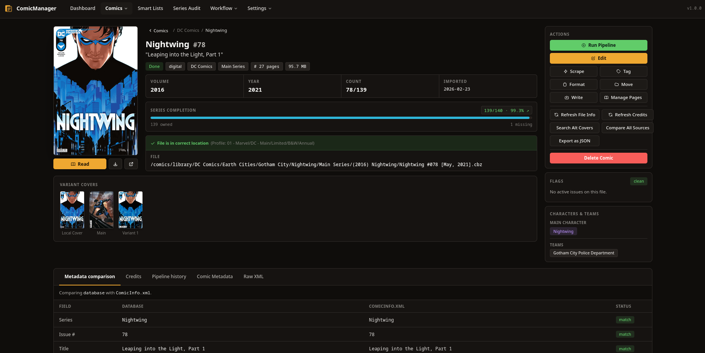
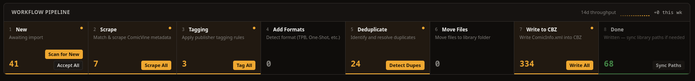

# ComicManager

A web application for managing large comic collections, both digital and physical. Built to replace the ComicRack workflow, it processes comics through an 8-phase pipeline from raw files to a fully organized, tagged, and metadata-enriched library.

  

## Features

- 8-phase workflow pipeline: New, Scrape, Tagging, Add Formats, Deduplicate, Move Files, Write to CBZ, Done
- ComicVine matching via pHash cover comparison, fuzzy metadata matching, and live API fallback
- I.N.D.U.C.K.S. integration as a second scraping source for Disney and European comics
- DataManager tagging rules engine for publisher-based metadata enrichment
- Format detection: Main Series, Limited Series, One-Shot, TPB, Omnibus, Annual, and more
- Duplicate detection by ComicVine ID, series and number, and perceptual hash
- Template-based Library Organizer with profile-based rules
- ComicInfo.xml generation and embedding into CBZ files
- Smart Lists: saved filter queries with optional ComicVine volume completion tracking
- Series Audit for tracking collection completeness by volume
- Audit log with per-action rollback support
- CBZ Page Manager for viewing and deleting pages inside CBZ files
- Multiple view modes: table, grid, compact, and hybrid
- Advanced searching with smart search tokens
- First-class physical comic support with the same pipeline workflow
- Handles 40,000+ comics with server-side pagination

## Get Started

- [Quick Start](https://comicmanager.baerentsen.space/guide/quickstart) - get up and running in minutes
- [Getting Started](https://comicmanager.baerentsen.space/guide/getting-started) - full walkthrough for new users

## Workflow

- [Workflow Pipeline](https://comicmanager.baerentsen.space/guide/workflow) - how comics move through the 8 phases
- [Scraping](https://comicmanager.baerentsen.space/guide/scraping) - ComicVine and I.N.D.U.C.K.S. matching
- [Tagging](https://comicmanager.baerentsen.space/guide/tagging) - publisher rules and metadata enrichment
- [Organizing](https://comicmanager.baerentsen.space/guide/organizing) - template-based folder organization
- [Writing Files](https://comicmanager.baerentsen.space/guide/writing) - embedding ComicInfo.xml into CBZ files

## Features & Reference

- [Searching & Filtering](https://comicmanager.baerentsen.space/guide/searching) - search tokens and filter options
- [Smart Lists](https://comicmanager.baerentsen.space/guide/smart-lists) - saved filters and collection tracking
- [Physical Comics](https://comicmanager.baerentsen.space/guide/physical-comics) - managing physical collections
- [Audit Log & Rollback](https://comicmanager.baerentsen.space/guide/audit-log) - track changes and roll back actions
- [Settings Reference](https://comicmanager.baerentsen.space/reference/settings) - all configurable options
- [Philosophy & Scope](https://comicmanager.baerentsen.space/guide/philosophy) - what ComicManager is and is not

## AI Usage

AI was used for the UI redesign (Claude Design). The old design can be seen in [`docs/public/old_UI/`](docs/public/old_UI/). AI was also used for the first draft of documentation and code comments. Code and architecture are human-made. 
